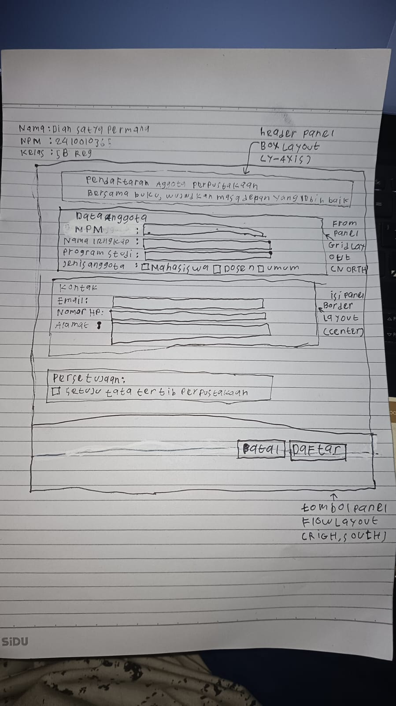
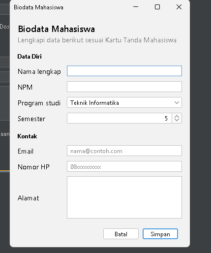
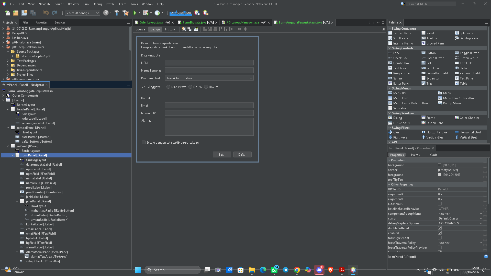

# P04 --- Layout Manager dan Desain Form

## Identitas Mahasiswa

-   Nama: Dian Satya Permana
-   NPM:2410010365
-   Program Studi: Teknik Informatika
-   Mata Kuliah: Pemrograman Berbasis Objek 2 (PBO 2)
-   Proyek:`p04-layout-manager`

## Deskripsi

Proyek ini dibuat untuk memenuhi Praktikum PBO 2 Pertemuan 4 tentang
Layout Manager dan Desain Form menggunakan Java Swing di Apache
NetBeans. Praktikum ini membahas penggunaan `BorderLayout`,
`FlowLayout`, `GridLayout`, `BoxLayout`, dan `GridBagLayout`, serta
penerapan layout bersarang agar form tetap rapi saat ukuran jendela
diubah.

## Tujuan Praktikum

1.  Memahami perilaku beberapa layout manager pada Java Swing.
2.  Mengatur layout panel melalui menu **Set Layout** di NetBeans.
3.  Menyusun beberapa panel dengan layout yang berbeda.
4.  Membuat form dengan label dan isian yang tetap rapi saat jendela
    diperbesar.
5.  Menerapkan prinsip keselarasan, kedekatan, dan konsistensi pada
    desain form.

## Tabel Rancangan Form Anggota Perpustakaan

  -----------------------------------------------------------------------
  Bagian                  Panel/Komponen          Layout
  ----------------------- ----------------------- -----------------------
  Jendela                 `JFrame`                `BorderLayout`

  Header                  `headerPanel`           `BoxLayout (Y_AXIS)`

  Isi form                `isiPanel`              `BorderLayout`

  Form isian              `formPanel`             `GridBagLayout`,
                                                  ditempatkan di bagian
                                                  `NORTH` pada `isiPanel`

  Tombol                  `tombolPanel`           `FlowLayout (RIGHT)`
  -----------------------------------------------------------------------

Jendela utama menggunakan `BorderLayout` dengan header di bagian
`NORTH`, isi form di bagian `CENTER`, dan tombol di bagian `SOUTH`.
`formPanel` diletakkan di `NORTH` pada `isiPanel` supaya baris form
tetap berada di bagian atas ketika jendela ditinggikan.

## Komponen Form Anggota Perpustakaan

### Data Anggota

-   NPM --- `JTextField`
-   Nama lengkap --- `JTextField`
-   Program studi --- `JComboBox`
-   Jenis anggota --- `JRadioButton` dalam `ButtonGroup`, dengan pilihan
    Mahasiswa, Dosen, dan Umum

### Kontak

-   Email --- `JTextField` dengan placeholder
-   Nomor HP --- `JTextField` dengan placeholder
-   Alamat --- `JTextArea`

### Persetujuan

-   Checkbox "Setuju dengan tata tertib perpustakaan" --- `JCheckBox`

### Tombol

-   Batal
-   Daftar

Tombol Daftar dijadikan tombol default. Sesuai modul, event handling
atau aksi tombol belum dibuat karena akan dibahas pada Pertemuan 5.

## Foto Sketsa dan Tabel Rancangan

Foto sketsa form:

Tabel rancangan layout dituliskan pada bagian **Tabel Rancangan Form
Anggota Perpustakaan** di atas.

## Screenshot Form Saat Dijalankan

### Ukuran Awal

### Ukuran Saat Jendela Dilebarkan

### Tab Design dan Navigator

Screenshot berikut memperlihatkan susunan panel dan layout pada tab
Design di NetBeans.

## Jawaban Eksperimen Praktikum 2 --- Galeri Layout Manager

### 1. FlowLayout diubah menjadi Center, lalu jendela diperkecil. Apa yang berubah? Baris mana di `initComponents()` yang berubah?

Tombol-tombol menjadi berada di tengah panel. Ketika jendela diperkecil
dan semua tombol tidak muat dalam satu baris, tombol akan berpindah ke
baris berikutnya. Baris kode yang berubah adalah pengaturan alignment
pada `flowPanel`, yaitu nilai alignment yang semula rata kiri menjadi
`FlowLayout.CENTER`.

### 2. Pada `gridPanel`, Rows diubah menjadi 0 dan Columns menjadi 2. Berapa baris yang terbentuk dan mengapa?

Jika terdapat 9 tombol, akan terbentuk 5 baris dengan 2 kolom. Baris
terakhir hanya berisi satu tombol. Nilai `Rows = 0` membuat jumlah baris
ditentukan otomatis berdasarkan jumlah komponen dan jumlah kolom yang
ditentukan.

### 3. Pada `boxPanel`, `maximumSize` keempat tombol diatur dengan lebar 32767 dan tinggi sebesar tinggi tombol. Bagaimana lebar tombol berubah? Apa fungsi Vertical Strut?

Tombol dapat melebar secara horizontal mengikuti ruang yang tersedia,
tetapi tingginya tetap sesuai tinggi tombol. Vertical Strut memberi
jarak vertikal tambahan di antara tombol sehingga susunannya tidak
terlalu rapat.

## Jawaban Eksperimen Praktikum 4 --- Form Biodata

### 1. `Weight X` pada `namaField` diubah menjadi 0.0, lalu jendela dilebarkan. Apa yang terjadi?

Kolom nama tidak lagi menerima bagian tambahan dari ruang horizontal.
Akibatnya, kolom isian tidak melebar mengikuti pertambahan lebar jendela
seperti ketika `Weight X = 1.0`.

### 2. Direction `formPanel` di dalam `isiPanel` diubah dari `North` menjadi `Center`, lalu jendela ditinggikan. Apa perbedaannya?

Saat `formPanel` berada di `North`, form tetap menempel di bagian atas
`isiPanel`. Jika diubah menjadi `Center`, form ditempatkan di tengah
ruang yang tersedia sehingga ada ruang kosong di atasnya ketika jendela
ditinggikan.

### 3. Baris `setMinimumSize(getSize())` dihapus, lalu jendela diperkecil sekecil mungkin. Bagian mana yang rusak lebih dulu?

Tanpa ukuran minimum, jendela dapat diperkecil terlalu jauh. Bagian yang
lebih dulu terlihat bermasalah adalah susunan form: kolom isian
menyempit, teks atau komponen bisa terpotong, dan tombol dapat menjadi
sulit dilihat atau digunakan.

## Pemeriksaan Form oleh Teman --- Tahap 4

Nama teman: Daffa Masyu Abas\
NPM teman: 2410010481

  ------------------------------------------------------------------------
                           No. Pemeriksaan           Hasil
  ---------------------------- --------------------- ---------------------
                             1 Label singkat, jelas, Ya
                               dan sejajar           

                             2 Isian dikelompokkan   Ya
                               dengan judul bagian   

                             3 Placeholder dipakai   Ya
                               untuk isian yang      
                               punya format          

                             4 Komponen sesuai jenis Ya
                               data                  

                             5 Tombol utama menonjol Ya
                               dan berada di kanan   
                               bawah                 

                             6 Jarak antar komponen  Ya
                               konsisten             

                             7 Form tetap rapi saat  Ya
                               jendela dilebarkan    
                               dan ditinggikan       

                             8 Tampilan dibuat       Ya
                               dengan JFrame Form    
                               dan layout manager,   
                               bukan Null Layout     
                               atau Absolute Layout  
  ------------------------------------------------------------------------

Saran dari teman: 1. Font pada label header dibuat **bold** dengan
ukuran 14 agar judul lebih jelas. 2. `JTextField` NPM diberi
placeholder, misalnya "Contoh: 24100000.."**, agar pengguna mengetahui
format NPM yang harus dimasukkan.

## Jawaban Pertanyaan Refleksi --- Bagian G

### 1. Mengapa Null Layout dan Absolute Layout sebaiknya dihindari?

Karena posisi dan ukuran komponen ditentukan secara manual, sehingga
tampilan tidak menyesuaikan ukuran jendela dan teks dapat terpotong pada
skala layar yang berbeda.

### 2. Jelaskan perbedaan perilaku FlowLayout dan GridLayout saat jendela dilebarkan.

`FlowLayout` menyusun komponen berderet dan dapat memindahkan komponen
ke baris berikutnya jika ruang tidak cukup. `GridLayout` menyusun
komponen dalam sel yang sama besar; saat ukuran jendela berubah, ukuran
sel ikut berubah.

### 3. Apa fungsi Weight X dan Fill pada constraint GridBagLayout?

`Weight X` mengatur pembagian sisa ruang horizontal. Nilai `1.0` pada
kolom isian membuat kolom tersebut menerima ruang tambahan.
`Fill = HORIZONTAL` membuat komponen memenuhi lebar selnya.

### 4. Mengapa formPanel dibungkus isiPanel dan diletakkan di North?

Agar form tetap berada di bagian atas ketika jendela ditinggikan,
sementara ruang kosong tambahan berada di bawah form.

### 5. Sebutkan dua prinsip desain yang diterapkan dan buktinya.

-   Keselarasan: Label dan kolom isian disusun sejajar sehingga
    mudah dibaca.
-   Kedekatan: Isian yang berkaitan dikelompokkan di bawah judul
    bagian, seperti Data Anggota, Kontak, dan Persetujuan.

## Deklarasi Penggunaan AI

Saya menggunakan ChatGPT sebagai alat bantu untuk memahami materi
layout manager, menyusun draf README, dan merapikan jawaban eksperimen
serta refleksi berdasarkan Modul Praktikum PBO 2 Pertemuan 4. Rancangan,
implementasi program, screenshot, dan hasil akhir diperiksa serta
disesuaikan dengan pekerjaan praktikum saya.

## Referensi

1.  Modul Praktikum Pemrograman Berbasis Objek 2, Pertemuan 4: *Layout
    Manager dan Desain Form*, Fakultas Teknologi Informasi, Program
    Studi Teknik Informatika, Universitas Islam Kalimantan Muhammad
    Arsyad Al Banjari.
2.  Oracle. *The Java Tutorials: A Visual Guide to Layout Managers*.
    https://docs.oracle.com/javase/tutorial/uiswing/layout/
3.  Oracle. *The Java Tutorials: How to Use GridBagLayout*.
    https://docs.oracle.com/javase/tutorial/uiswing/layout/gridbag.html
4.  Apache NetBeans. *Designing a Swing GUI in NetBeans IDE*.
    https://netbeans.apache.org/
5.  FormDev Software. *FlatLaf*. https://www.formdev.com/flatlaf/

