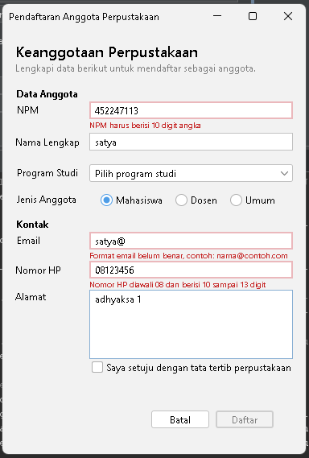
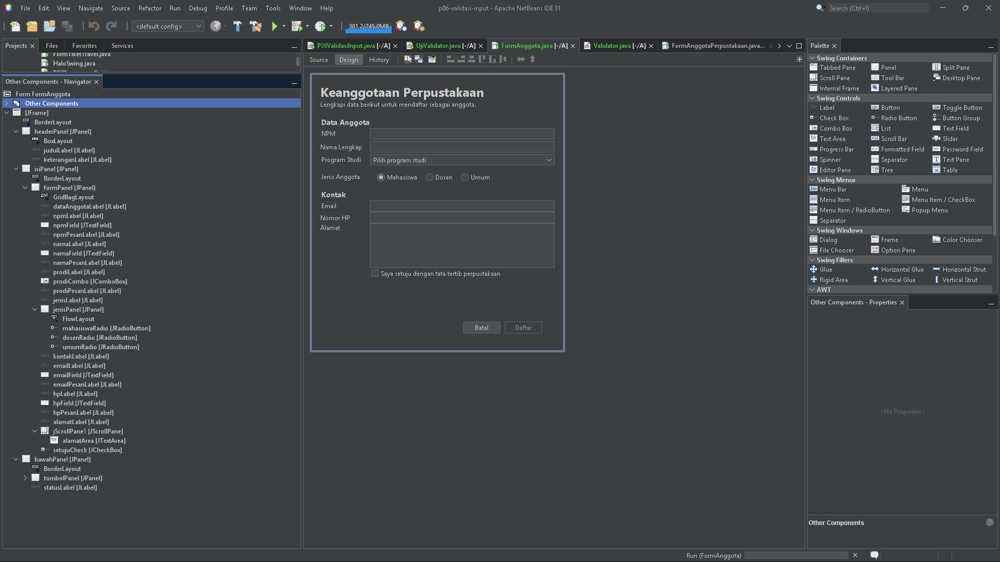
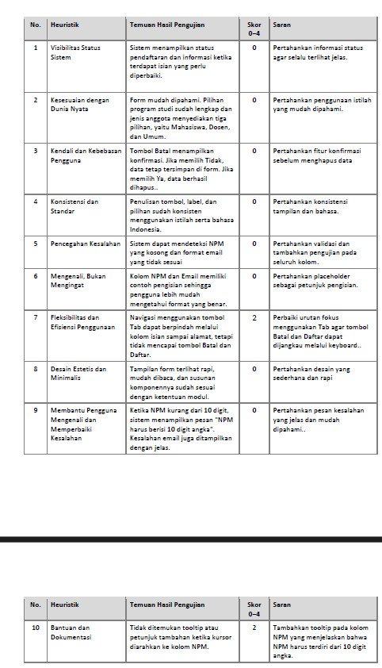

# P06 – Validasi Input dan Kegunaan

## 1. Identitas Proyek

- **Mata Kuliah:** Pemrograman Berbasis Objek 2
- **Modul:** Pertemuan 6 – Validasi Input dan Kegunaan
- **Nama:** Dian Satya Permana
- **NPM:** 2410010365
- **Nama Proyek:** `p06-validasi-input`
- **Repository:** `pbo2-2410010365`
- **Tautan Repository:** https://github.com/satyapermana350-debug/pbo2-2410010365
- **Form:** `FormAnggotaPerpustakaan`

## 2. Deskripsi Proyek

Proyek ini merupakan implementasi validasi input dan peningkatan kegunaan pada Form Anggota Perpustakaan menggunakan Java Swing dan NetBeans GUI Builder.

### Fitur yang diterapkan

- Validasi NPM sebanyak 10 digit angka.
- Validasi nama.
- Validasi format email.
- Validasi nomor HP.
- Validasi pilihan program studi.
- Aturan validasi dikumpulkan di kelas `Validator` dan diuji melalui `UjiValidator`.
- Pencegahan karakter selain angka pada kolom NPM melalui event `keyTyped`.
- Pesan kesalahan pada label di bawah isian.
- Penanda garis merah pada kolom yang salah.
- Ringkasan jumlah kesalahan dan fokus ke isian pertama yang salah.
- Konfirmasi sebelum mengosongkan form.
- Tombol Daftar aktif setelah persetujuan dicentang.
- Aksesibilitas dasar: properti `labelFor`, `displayedMnemonic`, `mnemonic`, dan `toolTipText` pada isian NPM.

## 3. Screenshot Hasil Praktikum

### 3.1 Form dengan Pesan Kesalahan



### 3.2 Navigator dengan Label Pesan



## 4. Hasil Peer Review

Peer review dilakukan oleh **Muhammad Zihni Syauqi** terhadap form milik **Dian Satya Permana**.



## 5. Temuan, Perbaikan, dan Commit

| No. | Temuan Peer Review | Skor | Perbaikan yang Dilakukan | Commit |
|---|---|---|---|---|
| 1 | Navigasi Tab belum mencapai tombol Batal dan Daftar. | 3 (Mayor) | Mengatur ulang urutan komponen melalui jendela Navigator (Move Up/Move Down). | `ISI_HASH_COMMIT_1` |
| 2 | Belum tersedia tooltip pada kolom NPM. | 2 (Minor) | Menambahkan `toolTipText` pada `npmField` dengan isi "NPM harus terdiri dari 10 digit angka." | `ISI_HASH_COMMIT_2` |

## 6. Jawaban Eksperimen Praktikum 4

### 1. Ketik huruf pada isian NPM. Apa yang terjadi dan baris mana di `npmFieldKeyTyped` yang menyebabkannya?

Karakter huruf tidak dimasukkan ke isian NPM. Penyebabnya adalah baris berikut:

```java
if (!Character.isDigit(evt.getKeyChar()) || penuh) {
    evt.consume(); // karakter tidak dimasukkan ke isian
}
```

Jika karakter bukan angka, atau jumlah digit sudah mencapai 10, `evt.consume()` dijalankan sehingga karakter dibatalkan.

### 2. Isi email dengan `siti@`, lalu tekan Tab. Kapan pesan kesalahan muncul?

Pesan kesalahan muncul saat pengguna meninggalkan kolom Email, yaitu ketika event `focusLost` dijalankan. Event tersebut memanggil `periksaEmail()`, dan karena format tidak sesuai, pesan "Format email belum benar, contoh: nama@contoh.com" ditampilkan di bawah isian.

### 3. Klik isian Nama tanpa mengetik, lalu tekan Tab. Mengapa tidak ada pesan kesalahan?

Karena event `focusLost` hanya memeriksa isian yang tidak kosong (`if (!namaField.getText().isBlank())`). Isian kosong baru diperiksa saat tombol Daftar diklik, agar pengguna tidak langsung mendapat pesan kesalahan hanya karena melewati kolom.

### 4. Centang persetujuan, lalu klik Daftar dengan form kosong. Isian mana yang mendapat fokus?

Fokus diarahkan ke kolom NPM, yaitu isian pertama yang salah. Method `daftar()` memeriksa semua isian dan menyimpan komponen yang tidak valid ke dalam daftar `salah`. Baris `salah.get(0).requestFocusInWindow()` kemudian memindahkan fokus ke kesalahan pertama.

### 5. Tekan tombol Alt bersama huruf N. Isian mana yang mendapat fokus, dan properti apa yang mengaturnya?

Fokus berpindah ke `namaField` (kolom Nama lengkap). Hal ini diatur oleh properti `displayedMnemonic` (huruf N) pada label Nama lengkap, yang dihubungkan ke isian melalui properti `labelFor`.

### 6. Isi beberapa isian, lalu klik Batal dan pilih No. Apakah data tetap ada?

Ya, data tetap ada. Ketika pengguna memilih No pada dialog konfirmasi, method `batal()` menjalankan `return` sehingga `kosongkan()` tidak dipanggil.

## 7. Jawaban Pertanyaan Refleksi Modul (Bagian H)

### 1. Mengapa aturan validasi dipisahkan ke kelas Validator, bukan ditulis langsung di event handler?

Aturan validasi dipisahkan ke kelas `Validator` agar kode lebih terstruktur dan mudah dikelola. Event handler menangani interaksi pengguna, sedangkan `Validator` memeriksa kebenaran data. Aturan validasi juga lebih mudah diuji tanpa menjalankan GUI, seperti yang dilakukan pada `UjiValidator`, dan dapat dipakai ulang oleh beberapa event.

### 2. Mengapa isian kosong tidak langsung ditandai merah saat pengguna hanya melewatinya?

Karena pengguna mungkin belum sempat mengisi kolom tersebut. Jika kolom kosong langsung ditandai merah, pengguna dapat merasa terganggu. Oleh karena itu, pemeriksaan isian kosong dilakukan ketika tombol Daftar diklik.

### 3. Sebutkan tiga heuristik Nielsen yang diterapkan pada form Anda beserta buktinya.

- **Pencegahan Kesalahan:** Kolom NPM hanya menerima angka dan dibatasi maksimal 10 digit melalui `npmFieldKeyTyped` yang memanggil `evt.consume()`.
- **Membantu Memperbaiki Kesalahan:** Method `tandai()` menampilkan pesan kesalahan yang jelas pada label di bawah kolom yang tidak valid, misalnya "NPM harus berisi 10 digit angka".
- **Kendali dan Kebebasan Pengguna:** Method `batal()` menampilkan dialog konfirmasi sebelum data dihapus, dan pengguna dapat memilih No untuk membatalkan.

### 4. Mengapa pesan kesalahan tidak boleh hanya berupa warna merah?

Karena sebagian pengguna buta warna dan tidak dapat membedakan warna dengan mudah. Pesan kesalahan harus disertai tulisan yang menjelaskan bagian yang salah dan cara memperbaikinya agar dapat dipahami oleh semua pengguna.

### 5. Temuan peer review mana yang paling bermanfaat bagi Anda dan mengapa?

Temuan yang paling bermanfaat adalah masalah navigasi menggunakan tombol Tab dan belum adanya tooltip pada kolom NPM. Temuan tersebut menunjukkan bahwa form tidak hanya perlu memiliki validasi yang benar, tetapi juga harus mudah digunakan dengan keyboard dan memberikan petunjuk kepada pengguna.

## 8. Deklarasi Penggunaan AI

Dalam pengerjaan tugas Modul 6 ini, saya menggunakan **ChatGPT (OpenAI)** dan **Claude (Anthropic)** sebagai alat bantu untuk:

1. Membantu memahami materi validasi input dan kegunaan.
2. Membantu memahami dan menyusun jawaban eksperimen Praktikum 4.
3. Membantu menyusun refleksi berdasarkan heuristik Nielsen.
4. Membantu memeriksa lembar peer review dan menyusun dokumentasi proyek dalam file README.md.

Penggunaan AI hanya sebagai alat bantu pembelajaran dan penyusunan dokumentasi. Implementasi, pengujian, dan penyesuaian program dilakukan sendiri pada proyek praktikum.

## 9. Kesimpulan

Validasi input penting untuk memastikan data yang dimasukkan pengguna sesuai dengan ketentuan. Pesan kesalahan yang jelas membantu pengguna memperbaiki data, sedangkan konfirmasi pembatalan memberikan kendali agar data tidak terhapus secara tidak sengaja.

Penerapan heuristik Nielsen juga membantu meningkatkan kemudahan penggunaan, konsistensi, dan aksesibilitas pada Form Anggota Perpustakaan.
